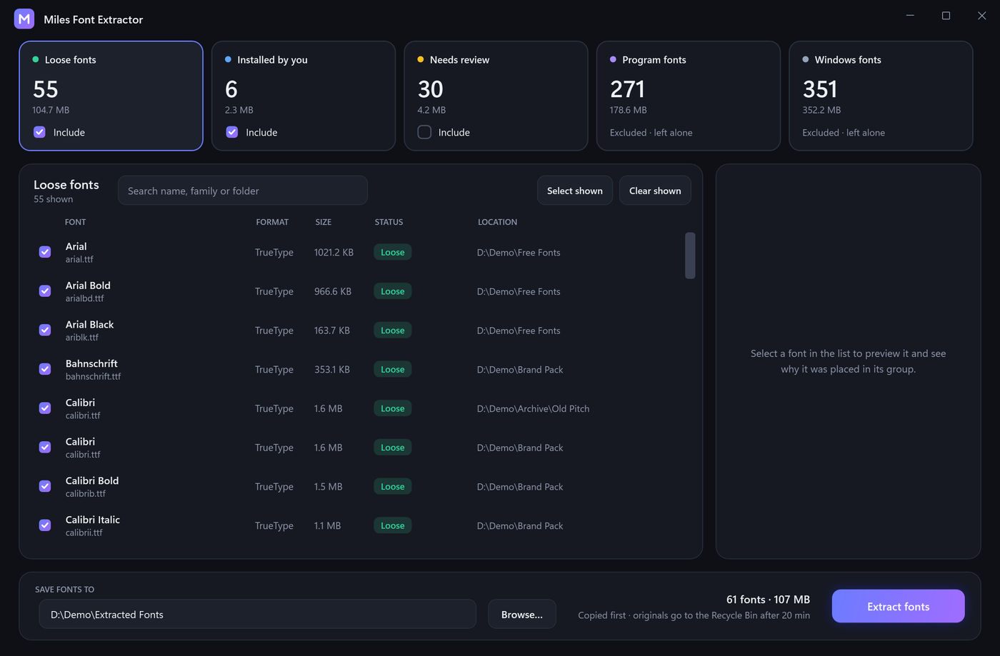

<div align="center">


# Miles Font Extractor

**Find the loose fonts on your PC and gather them in one folder.**
Windows and installed-program fonts are left alone.

[](https://github.com/milesARG/miles-font-extractor/releases/latest)
[](https://github.com/milesARG/miles-font-extractor/actions)

[](LICENSE)

### [Download for Windows](https://github.com/milesARG/miles-font-extractor/releases/latest)



</div>

## How it works

1. **Scan** your drives, or just one folder.
2. **Review** the results. Every font is grouped, with the reason shown.
3. **Copy** the selected fonts to a folder you choose. Each copy is checked against its original.
4. **Clean up.** After 20 minutes the originals go to the Recycle Bin. You can keep them instead.

## What gets extracted

| Group | Meaning | Default |
|---|---|---|
| Loose | Downloads, Desktop, project folders, other drives | Selected |
| Installed by you | Your own account's fonts | Selected |
| Needs review | Unclear: next to an `.exe`, temp folders, Office add-ons | Not selected |
| Program | Inside Program Files, an installed app, or `node_modules` | Excluded |
| Windows | Shipped with Windows | Excluded |

A font is excluded only on evidence, never on a guess. Files are checked by their header, so renamed or corrupt ones are ignored.
Formats: TTF, OTF, TTC, WOFF, WOFF2, Type 1.

## Safe by design

- Copies are verified by SHA-256 before anything is removed. Nothing is overwritten; duplicates are merged.
- Originals are re-checked, then moved to the **Recycle Bin**, never permanently deleted. A changed original is kept.
- A `MilesFontExtractor-log.csv` in the destination records every file.
- Runs only while open. No startup entry, no service, no network access. About 50 MB of RAM.
- Per-user install, no admin prompt. Removing files from `C:\Windows\Fonts` offers an admin restart.

## Command line

`--folder "C:\path"` scans one folder (repeatable). `--dest "C:\path"` presets the destination.

## Build

Needs the [.NET 8 SDK](https://dotnet.microsoft.com/download/dotnet/8.0) and [Inno Setup 6](https://jrsoftware.org/isinfo.php).

```powershell
powershell -ExecutionPolicy Bypass -File build.ps1   # dist\MilesFontExtractor-Setup-1.0.0.exe
```

[MIT license](LICENSE)
