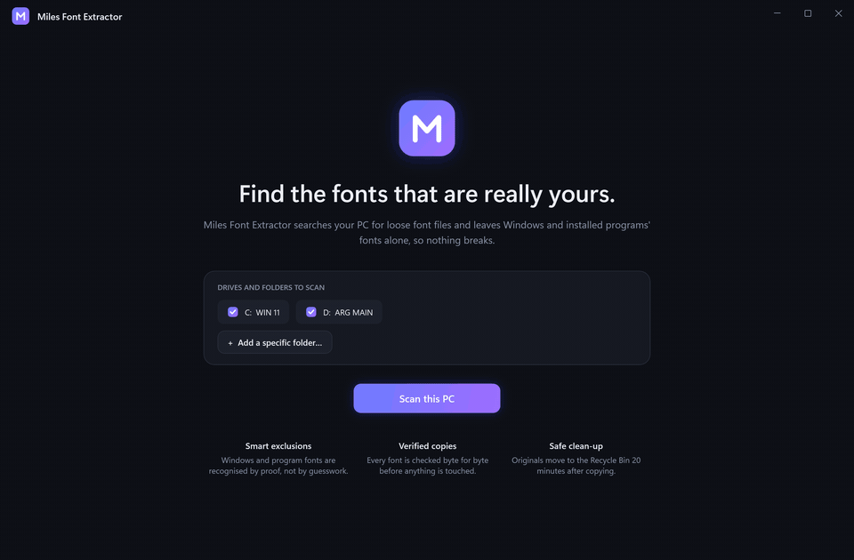

<div align="center">


# Miles Font Extractor

**Find every font that is really yours. Leave Windows and your programs alone.**

[](https://github.com/milesARG/miles-font-extractor/releases/latest)
[](https://github.com/milesARG/miles-font-extractor/actions)

[](LICENSE)

[**Download for Windows**](https://github.com/milesARG/miles-font-extractor/releases/latest)

<br>


</div>

<br>

A small Windows app that searches a PC for **loose font files** and gathers them into one folder. The fonts that belong to
Windows or to an installed program are recognised and left untouched, so nothing breaks.

It is built for a one-time job: it runs only while it is open, adds nothing to startup, and idles at about 37 MB of RAM.

<div align="center">

</div>

## How it decides what to leave alone

A font is excluded only when there is **proof**. Anything ambiguous is shown to you, never silently dropped.

| Group | Evidence | Default |
|---|---|---|
| **Loose** | Not part of Windows or any installed program (Downloads, Desktop, project folders, other drives) | Included |
| **Installed by you** | Installed for your account, in `%LOCALAPPDATA%\Microsoft\Windows\Fonts` | Included |
| **Needs review** | Ambiguous: next to an `.exe`, in a temp folder, or in the Windows font folder but not shipped with Windows (Office add-ons) | Shown, **not** selected |
| **Program** | Inside the folder of an installed program (from the Uninstall registry), Program Files, ProgramData, an app's AppData folder, or a bundled dependency folder such as `node_modules` | Excluded |
| **Windows** | Under `C:\Windows`, owned by *TrustedInstaller*, or a Microsoft font in the Windows font folder | Excluded |

Files are validated by reading the font header, so renamed or corrupt files are ignored. Supported: TTF, OTF, TTC/OTC,
WOFF, WOFF2, Type 1 and bitmap fonts.

A registered install folder is rejected when it is too broad to mean "one program": a drive root, the Windows folder, Program Files
itself, or anything that contains your Desktop or Documents. A folder called *Fonts* in Downloads is never mistaken for a program.

## What happens to your files

<table>
<tr>
<td width="50%"></td>
<td width="50%"></td>
</tr>
<tr>
<td><b>Review.</b> Preview any font and see exactly why it was placed in its group.</td>
<td><b>Verify.</b> Copies are checked, then a 20-minute countdown starts before anything is removed.</td>
</tr>
</table>

1. **Copy.** Selected fonts are copied to the folder you choose. Identical files are merged (by SHA-256), and name clashes are renamed. Nothing is overwritten.
2. **Verify.** Every copy is hashed and compared with its original.
3. **Wait 20 minutes.** Open the folder and check your fonts. **Keep originals** cancels the clean-up. If you close the app, the countdown resumes on the next launch.
4. **Remove.** Each original is re-verified against its copy and then moved to the **Recycle Bin**, not permanently deleted. A changed original or an unverifiable copy is always kept.
5. **Log.** `MilesFontExtractor-log.csv` in the destination lists every font, where it came from and what happened to it.

Files in `C:\Windows\Fonts` need administrator rights to remove. The app offers **Restart as administrator** if any are left.

## Scan a specific folder

Use **Add a specific folder...** on the home screen to scan just one or two folders instead of whole drives. It takes seconds.

<div align="center">

</div>

## Command line

| Option | Effect |
|---|---|
| `--folder "C:\path"` | Scan just this folder instead of whole drives. Repeatable. |
| `--dest "C:\path"` | Preset the folder the fonts are saved to. |

## Build from source

Requires the [.NET 8 SDK](https://dotnet.microsoft.com/download/dotnet/8.0) and, for the installer, [Inno Setup 6](https://jrsoftware.org/isinfo.php).

```powershell
# run
dotnet run --project src/MilesFontExtractor -c Release

# installer: dist\MilesFontExtractor-Setup-1.0.0.exe
powershell -ExecutionPolicy Bypass -File build.ps1
```

The installer is self-contained (no .NET install needed), installs per user without an admin prompt, and adds no startup entry or service.

## Project layout

```
src/MilesFontExtractor/
  Core/          font reader, classifier, scanner, copy / verify / remove engine
  ViewModels/    app state and commands
  Controls/      logo mark, font specimen preview
  MainWindow.xaml, App.xaml   the interface (custom dark theme, no UI library)
installer/       Inno Setup script
tools/           brand assets, demo fonts, screenshot capture, demo GIF
website-assets/  screenshots and copy for the project page
docs/            logo, social preview, demo GIF
```

Screenshots are real 2x renders of the running app, captured by `tools/capture-screenshots.ps1` against a demo folder, so no
personal paths appear in them.

## License

[MIT](LICENSE)
